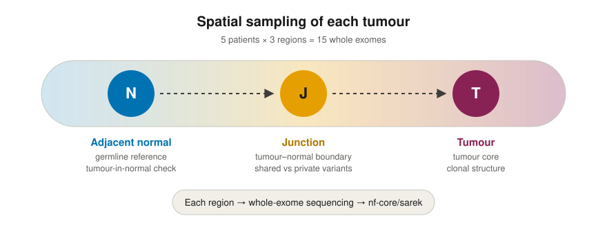
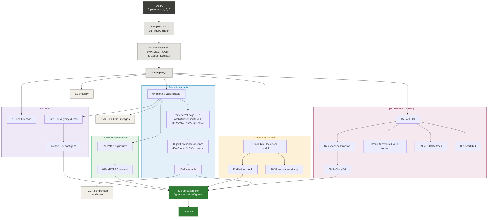

<h1 align="center">Spatial breast-cancer whole-exome analysis</h1>

<p align="center">
  Analysis code for a spatial whole-exome series of five breast tumours,<br>
  each sampled as <b>adjacent normal</b>, <b>junction</b> and <b>tumour</b>.
</p>

<p align="center">
  <a href="LICENSE"></a>
  <a href="https://github.com/drmahmoodhachim-gif/breast-cancer-spatial-wes/releases/tag/v0.1.0"></a>
  
  
  
  
  
</p>

<p align="center">
  
</p>

This repository is code only. Sequencing reads, alignments, variant tables and the clinical table are not included. The Word manuscript is the text of record; these scripts are the analysis named for that manuscript. An archive DOI has not been issued.

**Contents:** [Workflow](#workflow) · [Scripts by step](#scripts-by-step) · [Not in this repository](#not-in-this-repository) · [External tools](#external-tools-used-for-the-published-run) · [Licence](#licence)

## Workflow

Numbers are script prefixes in `scripts/`. Colours group the steps by analysis.



## Quick start

```bash
git clone https://github.com/drmahmoodhachim-gif/breast-cancer-spatial-wes
cd breast-cancer-spatial-wes
conda env create -f envs/analysis.yml          # also facets.yml, immune.yml, r_figures.yml
cp config/project.env.example config/project.env   # then edit the paths
```

Thresholds live in `config/filters.yaml`. `samtools` and `bcftools` must be on `PATH`.

## Scripts by step

One script for each step in the final analysis, in the order they were applied.

| Step | Script |
|---|---|
| Capture target | `scripts/00_prepare_bed.py` |
| FASTQ check | `scripts/01_fastq_headcheck.py` |
| Alignment and calling | `scripts/02_run_sarek.sh` |
| Sample QC | `scripts/03_collect_qc.py` |
| Primary variant table | `scripts/04_parse_variants.py` |
| Segmental-duplication and mapping-quality flags | `scripts/22_artefact_flags.py` |
| AlphaMissense and REVEL | `scripts/27_ensembl_missense.py` |
| MANE transcript | `scripts/37_mane_annotation.py` |
| gnomAD allele frequency | `scripts/41_gnomad_af.py`, `scripts/47_gnomad_review.py` |
| Joint presence and absence | `scripts/44_joint_absence.py` |
| DH00023 lineages | `scripts/38_sitelevel_lineage.py`, `scripts/33_revision_tables.py` |
| Indel and SNV recount | `scripts/46_indel_recount.py`, `scripts/42_recount_check.py` |
| Copy number | `scripts/05_run_facets.sh`, `scripts/05_facets.R` |
| Cancer-cell fraction | `scripts/07_ccf.py` |
| Copy-number events and whole-genome doubling fraction | `scripts/33_revision_tables.py`, `scripts/24_wgd_fraction.py` |
| MEDICC2 segment trees | `scripts/29_cn_phylogeny.py` |
| scarHRD | `scripts/09c_hrd_scar.R` |
| PyClone-VI | `scripts/08_pyclone.py` |
| Tumour-in-normal model | `scripts/06a_count_alleles.py`, `scripts/06b_lookback_model.py`, `scripts/45_slope_site_tests.py` |
| Dilution check | `scripts/17_dilution_test.py` |
| Mutation burden and signatures | `scripts/09_tmb_signatures.py` |
| APOBEC context | `scripts/09b_apobec_branch.py` |
| T-cell fraction | `scripts/11_tcell_extrect.R` |
| HLA typing and loss | `scripts/12_hla_typing.sh`, `scripts/13_hla_loh.py` |
| Neoantigens | `scripts/14_neoantigens.sh`, `scripts/35_neoantigen_recount.py`, `scripts/15_immune_summary.py` |
| Ancestry | `scripts/31_ancestry.py` |
| Rescue sensitivity | `scripts/26_rescue_sensitivity.py`, `scripts/39_rescue_ascertainment.py` |
| Driver table | `scripts/10_tables.py` |
| TCGA comparison | `catalogue/make_cbioportal_comparison.py`, `catalogue/make_cbioportal_subtype.py`, `catalogue/make_cbioportal_survival.py` |
| Figure refresh and audit | `scripts/40_publication_lock.py`, `scripts/99_audit.py` |

Figure scripts are under `scripts/figures/`. The oncoprint is `scripts/figures/r/fig2_oncoprint.R`. `scripts/figures/fig9_evolution_trees.py` draws variant counts. It is not a phylogeny.

Shared code is `scripts/lib/common.py`, `scripts/figures/fig_style.py`, and `scripts/figures/r/fig_style.R`. Thresholds are in `config/filters.yaml`. Environment files are in `envs/`.

## Not in this repository

<details>
<summary>Files that exist in the working analysis but are not part of the final paper</summary>

- `scripts/figures/fig2_oncoplot.py`, the earlier Python oncoprint
- `scripts/16_pathway_map.py` and `scripts/figures/fig8_pathways.py`
- `scripts/figures/figS1_seq_qc_from_multiqc.py` (no sequenced-section cellularity)
- `scripts/28_mtdna.py`, `scripts/23_chr7_phase.py`, `scripts/30_wgd_timing.py`
- `scripts/09d_hrd_cval_sensitivity.R`
- cloud-launch scripts, mail scripts, and one-off `_tmp_` scripts
- `run_all.sh`, because that runner still calls the dropped oncoprint and the pathway figure

</details>

Sequencing data, BAMs, VCFs, the clinical table, and local credential files are not in this repository. Scripts find files from this project folder, from `config/project.env`, or from the tools installed on the computer. Copy `config/project.env.example` to `config/project.env` and point it at local reference files before any rerun.

> [!WARNING]
> Do not rerun `scripts/02_run_sarek.sh`, `scripts/05_run_facets.sh`, `scripts/12_hla_typing.sh`, or `scripts/17_dilution_test.py` to recreate the published tables: those steps rewrite sequencing files.

## External tools used for the published run

nf-core/sarek 3.10.0, BWA-MEM 0.7.19-r1273, GATK 4.6.2.0, Mutect2, Strelka2 2.9.10, Ensembl VEP 116, FACETS 0.6.2, PyClone-VI 0.1.6, scarHRD 0.1.1, MEDICC2 1.1.2, SigProfilerAssignment with COSMIC SBS v3.4 restricted to SBS1, SBS2, SBS3, SBS4, SBS5, and SBS13, TcellExTRECT 1.0.3, OptiType through nf-core/hlatyping 2.2.0, MHCflurry 2.0.6, peddy 0.4.8. AlphaMissense and REVEL were read from the Ensembl REST API, release 116, on 14 October 2026. Analysis Python is the `wes-tjn` environment. Figures use R 4.3.3.

## Licence

These scripts are released under the MIT licence. See `LICENSE`. The external tools they call are installed separately, through `envs/` and nf-core/sarek, and keep their own licences.
